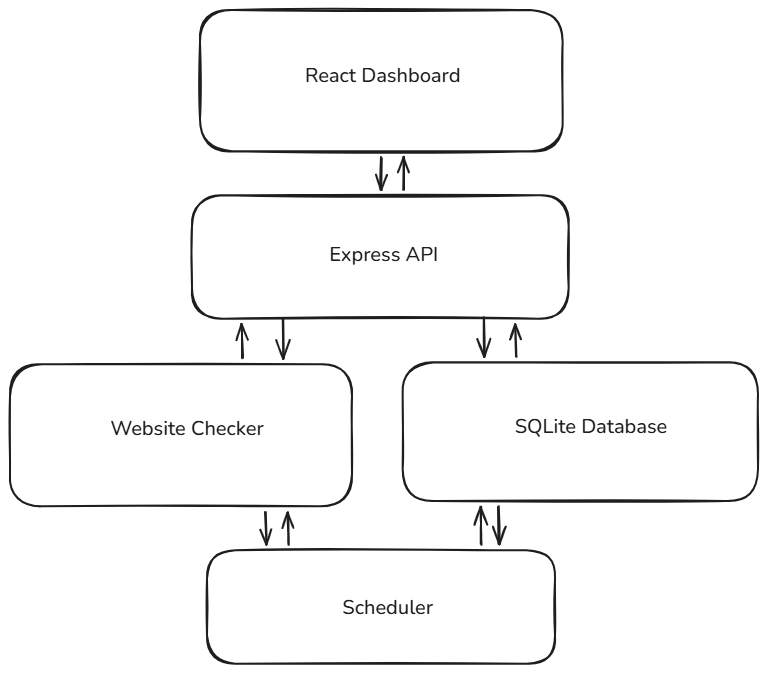

# Website Uptime Monitor

## Overview

A basic dashboard allowing users to gather uptime data of websites and check if a website is down. A website can be added to the dashboard through a link, and data is collected and stored locally. Advanced analysis features to be decided in the future.

## Development Stack

- **Frontend:** React JS + Vite
- **Backend:** Node JS + Express
- **Database:** SQLite + better-sqlite3

## Basic Design

Enter URL → Store URL as a single SQL instance with an ID and attached data → Get data → Update data → Update dashboard → Wait → Repeat

## Requirements

- Check if a website is online at intervals of time.
- Collect long-term data to show downtimes and uptimes.
- Be able to see response times and HTTP status.
- Have user data persistence.
- Be more specific about website status.
- Handle duplicate websites.

## UML Component Diagram

